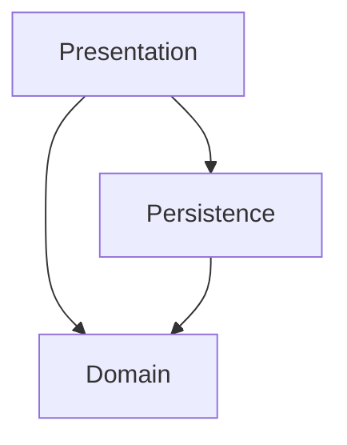
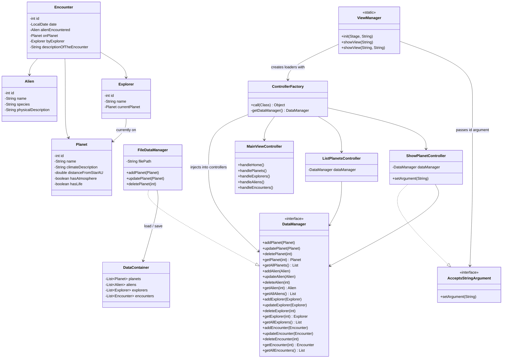
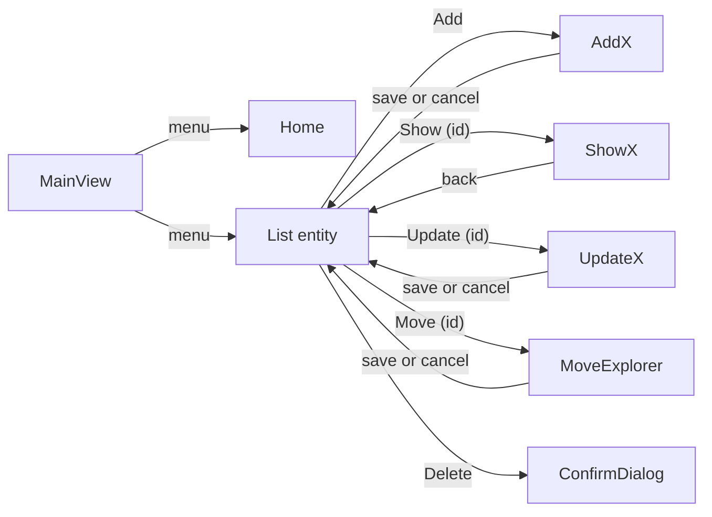

# Extraterrestrial Exploration (JavaFX)

A JavaFX solution for managing space exploration data: planets, explorers, alien species, and encounters.

This project reuses the **domain** and **persistence** design from the Session 20 CLI learning path, and replaces the console UI with a single-view JavaFX application (FXML in `resources`, fixed sidebar, swappable content area, controller factory).

## What the app does

Users can:

- Discover and manage **planets** (climate, distance from star, atmosphere, life)
- Register **explorers** and **move** them between planets
- Record **alien** species
- Log **encounters** between an explorer and an alien on a planet

Each entity has a list hub with Add / Show / Update / Delete. Explorers also have Move.

Data is stored in a binary file (`data.bin`) via Java serialization.

## How to run

Main class:

`extraterrestrialexploration.presentation.RunApplication`

Requires a JDK that includes JavaFX (e.g. Liberica Full).

## Architecture

The system uses a **layered architecture**:



| Layer | Responsibility |
|---|---|
| **Domain** | Entities and their relationships. No UI or file I/O. |
| **Persistence** | Save/load and CRUD through `DataManager`. |
| **Presentation** | JavaFX views, navigation, validation, user feedback. |

Dependencies point inward toward the domain. The domain never depends on presentation or persistence.

### Package layout

```
src/extraterrestrialexploration/
├── domain/
├── persistence/
└── presentation/
    ├── RunApplication.java
    ├── core/              ViewManager, ControllerFactory, AcceptsStringArgument
    └── controllers/
        ├── MainViewController
        ├── planetmanagement/
        ├── explorermanagement/
        ├── alienmanagement/
        └── encountermanagement/

resources/
├── fxml/                  MainView, Home, and per-entity feature views
└── css/styles.css
```

Controllers and FXML are grouped **per entity**, mirroring the CLI feature folders from Session 20.

## Class diagram



*(Only planet controllers are shown in the presentation part of the diagram; explorers, aliens, and encounters follow the same pattern.)*

## Design approaches

### Layered architecture

Clear separation of concerns:

- Domain classes stay free of JavaFX and file APIs.
- Persistence talks only to domain objects and the binary file.
- Controllers orchestrate UI and call `DataManager`; they do not own storage logic.

That makes it easier to swap the UI (CLI → JavaFX) without rewriting the model, which is exactly what this solution demonstrates.

### Single-view application (SPA-style shell)

Inspired by project `15_SingleViewApplication`:

- `MainView.fxml` is a `BorderPane` with a **fixed left menu** and an empty center.
- `ViewManager` keeps a reference to that `BorderPane` and loads feature FXML into `setCenter(...)`.
- The window never swaps the whole scene root for feature navigation; only the content area changes.

This keeps navigation consistent and feels like a single-page desktop app.

### FXML in the resource folder

Inspired by project `14_FxmlFilesInResourceFolder`:

- Views live under `resources/fxml/...`
- Controllers live under `src/.../controllers/...`
- `ViewManager` resolves views with `getResource("/fxml/" + viewName + ".fxml")`

View names include subfolders, e.g. `"planetmanagement/ListPlanets"`.

### Controller factory (dependency injection for FXML)

Inspired by project `17_ControllerFactoryExample`:

- Feature controllers take a `DataManager` in their constructor.
- FXMLLoader cannot call that constructor by itself, so `ControllerFactory` implements `Callback<Class<?>, Object>` and creates the right controller with a `FileDataManager`.
- `ViewManager` always calls `loader.setControllerFactory(new ControllerFactory())`.

This keeps persistence access consistent and avoids `new FileDataManager()` scattered through every handler method.

### List view as hub

Instead of one menu entry per CRUD action (CLI style), each entity has a **list view** as the hub:

- Table of existing entities
- Buttons: Add, Show, Update, Delete (and Move for explorers)
- Delete uses a confirmation dialog on the list itself
- Show / Update / Move navigate to a dedicated view with the selected id

That fits desktop UI better while still keeping one focused controller + FXML per feature.

### Passing ids between views

Show, Update, and Move controllers implement `AcceptsStringArgument`.

Flow:

1. List hub reads the selected entity id
2. Calls `ViewManager.showView(".../ShowPlanet", String.valueOf(id))`
3. Target controller parses the string back to `int` and loads the entity from `DataManager`

So navigation passes a lightweight identifier, not a stale object copy.

### Referential consistency in persistence

Domain objects hold **object references** (`Explorer.currentPlanet`, `Encounter` links, etc.). Serialization stores those graphs, so naive update/delete can leave stale or dangling data.

`FileDataManager` therefore:

- **Cascades updates**: when a planet/alien/explorer is updated, matching references in explorers/encounters are replaced in the same load/save cycle
- **Blocks unsafe deletes**: deleting a planet/alien/explorer that is still referenced throws `IllegalStateException` with a clear message; the list controllers catch it and show it to the user

Encounters can always be deleted (nothing else depends on them).

### External CSS styling

Styling lives in `resources/css/styles.css` and is attached to the scene in `ViewManager.init`.

FXML uses style classes (`sidebar`, `nav-button`, `card`, `primary-button`, `danger-button`, `message-error`, …) instead of long inline styles. Controllers switch message labels between `message-error` and `message-success`.

## Navigation overview


